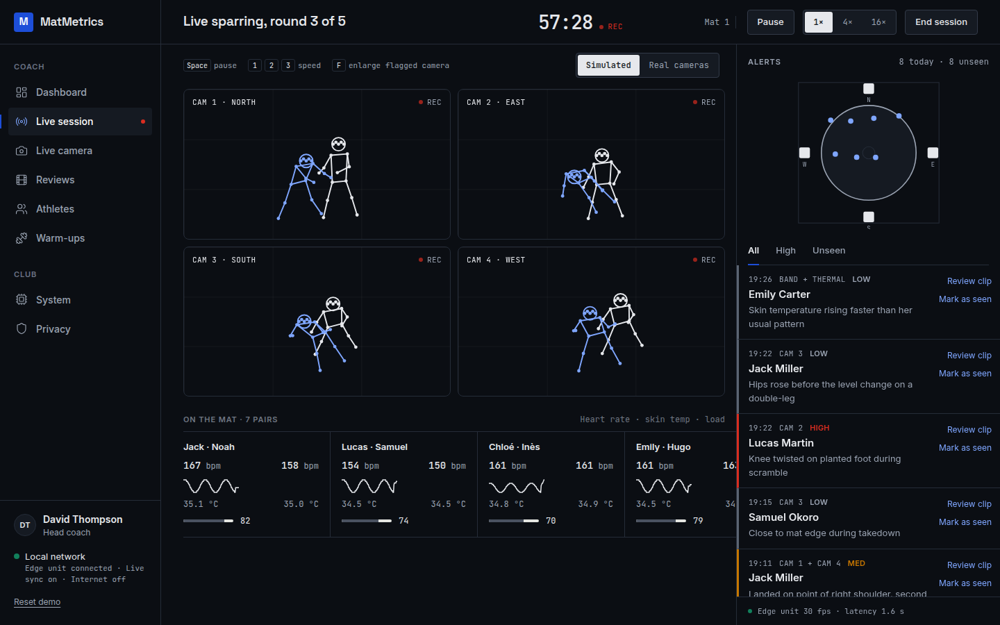
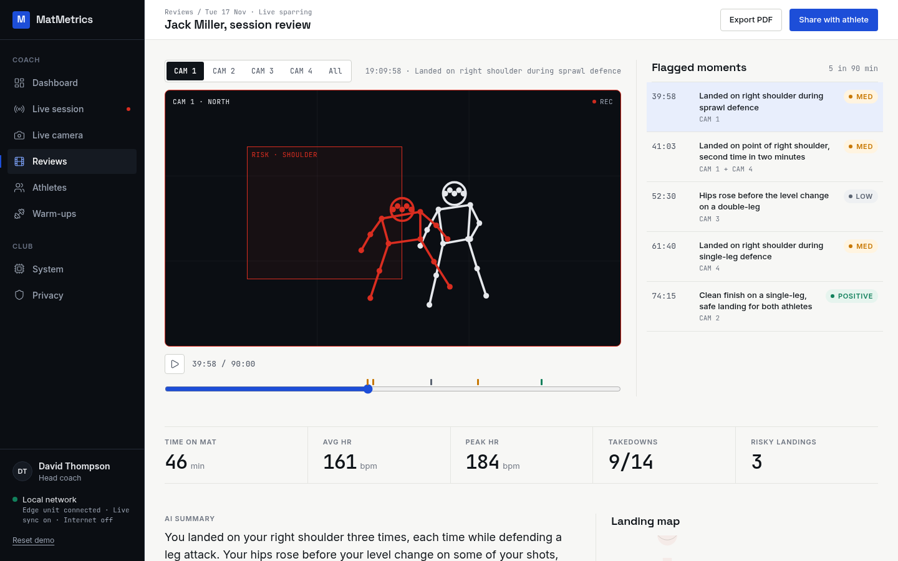
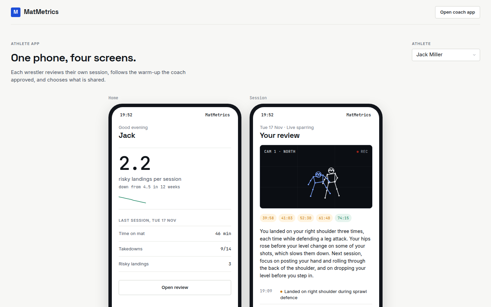
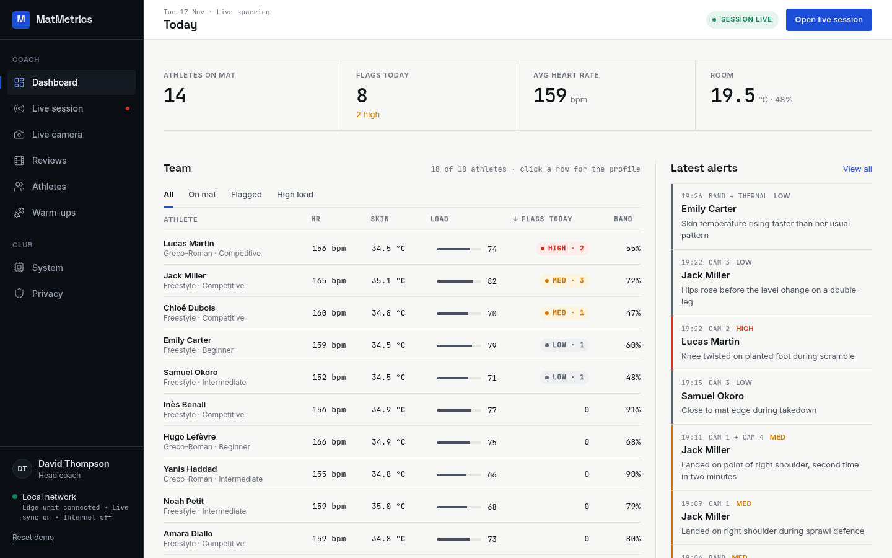
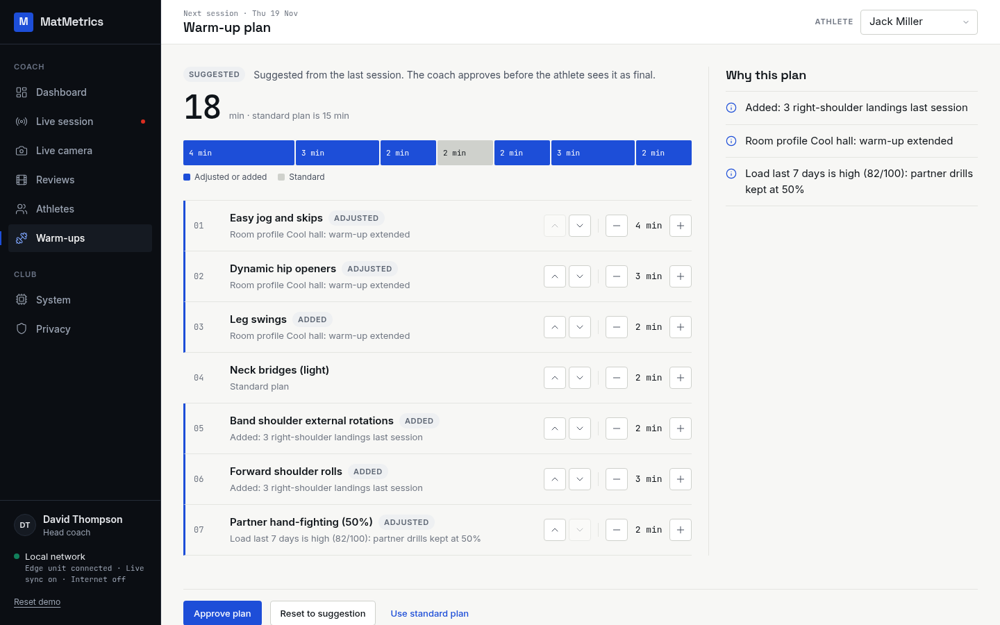
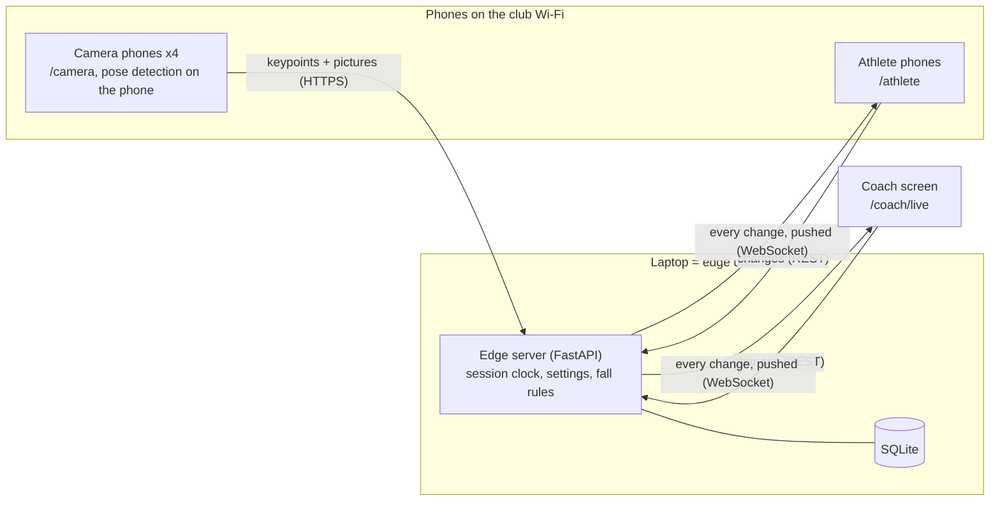

# MatMetrics

**Smart training for safer, better wrestling.** AI cameras around the mat, sensor wristbands and a
coach app that work together on the club's own network, so wrestlers get injured less and improve
faster.



This repository is a working prototype of MatMetrics, built for a pitch to judges and investors.
It has two parts:

- **The app** (React, TypeScript): the coach's tablet app, the athletes' phone app and a landing page.
  It runs on its own with seeded mock data, so every run tells the same story.
- **The edge server** (Python, FastAPI): plays the small computer that sits next to the mat. It keeps
  every screen in the room in sync over local Wi-Fi with no internet, and turns four ordinary phones
  into the camera ring, with live pose tracking and fall alerts.

## Credits

MatMetrics started as a team project for the Innovation Management course (M1, S7) at JUNIA.
The original prototype, its design system and its mock data were built by Jeremy O.A Boateng in
[nojetlag7/INNOVATION_MANAGEMENT_DEMO](https://github.com/nojetlag7/INNOVATION_MANAGEMENT_DEMO);
this repository keeps that full history. Kobi Ampem Afriyie built the edge server, live sync across
devices and the real camera mode.

## What it does

| Area | What you can do |
|---|---|
| Live session | Watch four camera views, an alert stream and heart rate for every pair; pause, speed up (1x, 4x, 16x), open a clip |
| Real cameras | Put four phones around the mat; each tracks body positions and the edge server flags head-first, shoulder and flat falls |
| Session review | Scrub a 90-minute timeline of flagged moments, read the AI summary, see the heart rate chart and landing map |
| Athletes | Compare the squad, open a profile with 12 weeks of progress ("Risky landings down 51% in 12 weeks") |
| Warm-ups | Review a warm-up that adapts to each athlete's last sessions, edit it and approve it |
| Athlete app | Four interactive phones: home, session review, approved warm-up with a countdown, privacy settings |
| Privacy | Per-athlete consent for vitals, video, research and cloud backup, set by the athlete |
| System | Devices, wristband batteries, room calibration, and QR codes for phones to join |

<table>
  <tr>
    <td></td>
    <td></td>
  </tr>
  <tr>
    <td></td>
    <td></td>
  </tr>
</table>

## How it fits together



- **Changes go in over REST, news comes out over one WebSocket.** Approve a plan on the laptop and
  it appears on every phone straight away.
- **The server stores only what people changed**, on top of the mock data in the app, so a reset
  is just "delete every change".
- **The server owns the session clock; the app owns the story.** Every screen plays the same
  scripted session from the same second.
- **It never breaks the demo.** Without a server (on Vercel, or if the server stops) each screen
  carries on by itself from the last shared state and reconnects later.
- **Real cameras:** each phone runs MediaPipe pose detection itself and sends about 1 KB of
  keypoints up to 10 times a second, plus a small picture a few times a second. The server looks
  for a fast drop of the hips and checks what landed first: head (HIGH), one shoulder (MED) or the
  back (MED). The same fall seen by several cameras becomes one alert.

## Run it

You need Node 20.19 or newer, and [uv](https://docs.astral.sh/uv/) for the edge server.

### The app on its own

```bash
npm install
npm run dev
```

Open http://localhost:5173. Each browser tab runs its own simulated session; settings are saved in
that browser.

### With the edge server (the full demo)

```bash
npm install && npm run build
cd server
uv sync
uv run matmetrics-edge
```

The first run downloads the pose model (about 5 MB) into `server/models/`; after that no internet
is needed. The server prints three addresses:

| Screen | Address |
|---|---|
| Coach, on the laptop | `http://localhost:8000/coach/live` |
| Athlete phones | `http://<laptop-ip>:8000/athlete` |
| Camera phones | `https://<laptop-ip>:8443/camera` |

The System page shows the phone addresses as QR codes. Click **Reset demo** in the sidebar just
before presenting: it restarts the session clock and clears all changes on every screen.

**Use a phone hotspot or your own router, not school or office Wi-Fi.** Those usually stop devices
on the network from reaching each other, so phones cannot reach the laptop.

### Real cameras: four phones around the mat

1. Put four phones on tripods around the mat, in landscape, at chest height, a few metres back, so
   both wrestlers are fully in view.
2. On each phone, scan **Use this phone as a camera** on the System page. Browsers only allow the
   camera on secure pages, so the edge server makes its own certificate: each phone warns once,
   tap Advanced, then continue.
3. Pick the phone's position (1 North, 2 East, 3 South, 4 West) and press **Start camera**.
4. On the coach's live page, switch **Simulated** to **Real cameras**.

Each camera shows its measured delay. Alerts only fire in Real cameras mode, never while a phone is
moving, and not in a camera's first three seconds. The person on the left of the picture is shown
as Jack Miller, the one on the right as Noah Petit.

These are simple rules, not a trained model: staged falls in clear view work well, but close
grappling, where two bodies overlap, will confuse them. Switch back to **Simulated** at any time.

## Project layout

```
src/
  features/        one folder per page (live, reviews, athletes, warmups, system, cameraNode, ...)
  components/      shared layout, data, chart, control and visual components
  state/           live session, settings, edge server connection, camera feeds
  data/            seeded mock data: athletes, sessions, flags, the scripted live session
server/
  edge/
    main.py        FastAPI app: REST endpoints, WebSocket, serving the built app
    live.py        the shared session clock
    store.py       SQLite storage for changes
    cameras.py     real camera feeds, alert merging across cameras
    detect.py      fall rules from pose keypoints
    tls.py         self-signed certificate for camera phones
  tests/           31 tests
docs/
  PROTOTYPE_SPEC.md   the original build spec for the prototype
  screenshots/
```

## Edge server API

| Method | Path | Purpose |
|---|---|---|
| GET | `/api/health` | Lets the app find the server |
| GET | `/api/state` | Settings changes and the live clock |
| PATCH | `/api/consents/{athleteId}` | Change privacy toggles |
| PUT | `/api/plans/{athleteId}` | Save or approve a warm-up plan |
| PUT | `/api/notes/{sessionId}:{athleteId}` | Save a coach note on a review |
| PUT | `/api/shared/{sessionId}:{athleteId}` | Share a review with the athlete |
| POST | `/api/system/calibration`, `/api/system/sync` | System page actions |
| POST | `/api/live/toggle`, `/speed`, `/end`, `/seen/{alertId}` | Live session controls |
| POST | `/api/live/cameras` | Switch between simulated and real cameras |
| POST | `/api/cameras/{camId}/pose` | A camera phone's keypoints |
| POST | `/api/cameras/{camId}/image` | A camera phone's picture (JPEG) |
| GET | `/api/cameras` | Which camera phones are sending, and real alerts |
| GET | `/api/time` | The server's clock, so phones can measure delay |
| POST | `/api/demo/reset` | Clear every change and restart the session |
| GET | `/api/join` | Addresses and QR codes for athlete and camera phones |
| WS | `/ws` | Pushes every change to every screen |

Interactive docs are at http://localhost:8000/docs while the server runs.

## Checks

```bash
npm run lint && npm run build                       # app: lint, types, build
cd server && uv run ruff check . && uv run pytest   # edge server: lint, 31 tests
```

GitHub Actions runs both on every push and pull request.

---

Demo data only. MatMetrics is a coaching tool, not a medical device.
